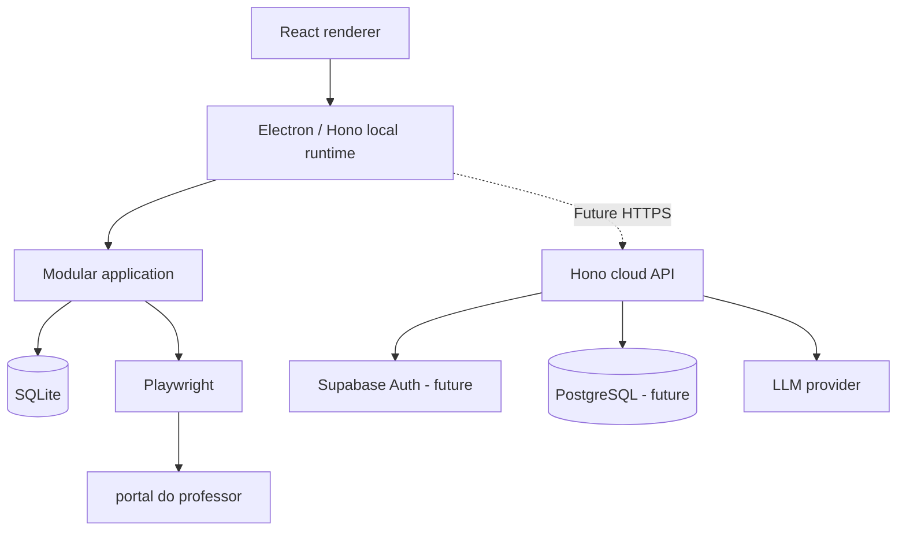
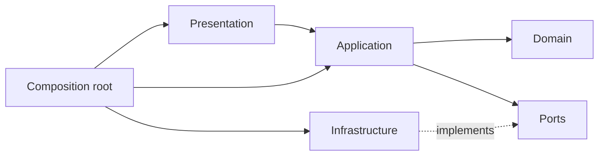

# Esmeraldinha architecture

Status: proposed target with a first integrated slice. Baseline: develop at `42c97882d896ef7473c7c5cb6c6558245d0decbf`. The separate Supabase migration branch is not a source of this design.

## Intent

Evolve the current desktop monolith into a modular monolith with explicit boundaries, use cases organized by feature (vertical slices), and selective Ports and Adapters. Use DDD for complex domain rules and simple functions for simple operations. Retain React, Hono, Electron, TypeScript, SQLite and Playwright during migration. Use the ubiquitous language in CONTEXT.md; do not translate domain terms into English identifiers.

## Default architecture for the current four-user installation

Treat the context map and module anatomy below as an evolution map, not a folder or implementation checklist. The current target is one modular application and one management installation. Keep existing React, Electron, Hono, TypeScript, SQLite, Playwright and direct typed calls. Add Supabase behind the same async identity ports as the local implementation; see [the small-installation authentication guide](authentication-migration.md).

```text
server/
  modules/<module>/
    index.ts            # public contract
    domain/            # only where real business rules justify it
    application/       # service functions, ports.ts when I/O differs
    __tests__/
  infrastructure/
    local/             # SQLite/local adapters
    supabase/          # remote adapters; English physical schema
  app.ts               # composition and routes
```

Start with identity and keep the other existing modules in place. Use simple services and repository functions, not mandatory entities, aggregates, commands, handlers, factories, mappers or folder layers. A repository interface is useful at a real persistence seam, not for every query. Prefer one database, one Hono process, memory sessions and direct calls. For remote use, hosted Hono is authoritative and Electron keeps Playwright. Do not create empty modules, workers, a workspace split, event bus, distributed locks or dedicated audit/subscription systems until a concrete use case warrants them. Preserve security and ownership checks, provider independence and regression tests regardless of user count.

## Current and target deployment

Today Electron hosts the UI and local Hono API; the API operates SQLite and Playwright. The local application remains the supported deployment during this refactor.



Future shared hosting is a separate deployment decision: central identity, authorization, data and subscriptions; local Playwright for assisted filling. The server is the authority for access and must treat the desktop as untrusted. Local automation reports observations, not authoritative proof of a portal write. Do not ship service-role keys or database credentials in Electron. Keep credenciais do professor in a dedicated encrypted store, preferably local unless a documented workflow requires central storage.

## Context map

These are candidate ownership boundaries, not a mandate to create separate packages immediately.

| Module | Owns | Existing starting point |
| --- | --- | --- |
| identity | conta, papel de acesso, authentication, application sessions and access policies | server/conta.ts, server/conta/ |
| professores | professor cadastro and profile; links to identity | server/professores.ts, server/professores/ |
| academics | turmas, estudantes, matrícula, período letivo | server/turmas.ts, server/turmas/ |
| cadernetas | grouping, aulas, conteúdo, frequência, completion | server/cadernetas.ts, server/cadernetas/ |
| boletim | avaliações, notas, classificação | server/notas/, shared/classificacao-de-notas.ts |
| fichas | ficha de desempenho, ficha descritiva, conceito | server/fichas/, shared/ficha-de-desempenho.ts |
| portal | credenciais do professor, sessions, discovery and portal adapter | server/scrape/, server/portal-sessions.ts, server/sessoes-headed.ts, server/sessoes-redis.ts |
| assistants | chat de conteúdos, chat de notas, structured outputs and rascunhos | server/ai/ and existing UI workflows |
| financial | valores recebidos and a receber; explicit read projections | existing caderneta stores and conta/valores.ts |
| operations | durable job lifecycle, sync, cancellation, retry and verification | existing synchronization and assisted filling routes |
| organizations / subscriptions / audit | future access scope, entitlements and traceability | not assumed to exist today |

Core identity, authentication workflows and authorization records remain provider-independent. Local SQLite/auth and Supabase infrastructure implement the same asynchronous application-owned ports. Their physical schemas may differ; map at the boundary and select the bundle only in composition. See [authentication migration](authentication-migration.md). Keep authorization within identity initially; extract a separate authorization module only if the policy surface warrants it. A professor may exist without an Esmeraldinha identity. Before hosting a second independent management customer, replace the single conta assumption with explicit organization memberships and grants.

## Module anatomy

```text
server/modules/<module>/
  index.ts                  # public API
  domain/                   # entities, value objects, pure policies (as needed)
  application/
    <feature>/              # command/query, handler, tests when justified
    ports/                  # interfaces owned by the consumer
  infrastructure/           # SQL, provider and browser adapters
  presentation/             # Hono/IPC adapters
  module.ts                 # composition (only when needed)
  __tests__/                # contract and domain tests
```

The first slice uses fewer files than this target on purpose. Do not add base Entity, Repository, command bus or generic Result frameworks without demonstrated need.



- Domain is pure and imports only its own domain. Cross-context concepts use explicit contracts and primitive IDs, not another module's entities.
- Application orchestrates use cases and consumes public contracts and ports. It never imports infrastructure, Hono, Electron or legacy stores directly.
- Presentation validates input, authenticates the caller, maps errors and serializes explicit DTOs. It does not decide domain invariants.
- Infrastructure implements persistence, encryption and provider ports. Composition is the only layer that selects concrete adapters.
- Other modules import the public index only; no private store imports. Prefer direct typed calls for immediate results. Add typed domain events for secondary reactions only. Critical security checks are synchronous; future durable events need an outbox.

## Source of truth and invariants

The portal is the only legally authoritative caderneta. SQLite/PostgreSQL snapshots, rascunhos and local progress must not be confused with confirmed portal data. Preserve professor/turma/período letivo relationships, matrícula-based matching, stable groups of 1–4 turmas de redução, existing conceito progression and classificação rules. The glossary in CONTEXT.md is authoritative for terms and current behavior; changes to pedagogy require a separate decision and tests.

AI proposes structured rascunhos; domain code calculates and validates; a human reviews and saves; a fresh sessão do portal verifies. Never give an LLM direct portal credentials or autonomous write access. Use distinct proposed, prepared and verified states, and do not blindly retry writes after an ambiguous result.

## Security and persistence

Authorization uses actor, action and resource loaded from trusted storage; deny by default for newly migrated use cases. The current auxiliary-wide access is a single-installation assumption, not a multi-tenant policy. Separate identity, membership, entitlement and portal credentials. Do not trust IDs, role claims or organization claims from request bodies. Preserve restricted primeiro acesso. On suspension or logout, deny subsequent access and cancel/close related portal sessions; review windows need actor/session ownership rather than just professorId.

A shared PostgreSQL database is acceptable, with module ownership and transactions. Cross-module foreign keys are acceptable where they enforce invariants. Only the owning module writes its data. Introduce tenant isolation and negative cross-tenant tests before hosting multiple customers; RLS is defense in depth, not a substitute for use-case authorization. Avoid dual writes; use transactional migrations and preserve IDs.

## What exists in this branch

- `server/modules/identity/domain`: existing identity type and pure access predicates.
- `application/resolve-session.ts`: one real use case with injected read ports.
- Legacy Hono middleware now calls this use case and the public module API. Existing session and database implementations remain unchanged.
- Existing caderneta access helper and financial response filter consume the centralized predicates.
- Vitest unit coverage and a static boundary check for migrated modules.

This is not a completed authorization redesign, provider migration, database migration, tenant implementation or security audit. Legacy generic route guards and response filtering remain as compatibility layers.

See [migration guide](migration.md), [authentication migration](authentication-migration.md) and [ADR 0001](../adr/0001-modular-monolith.md).
