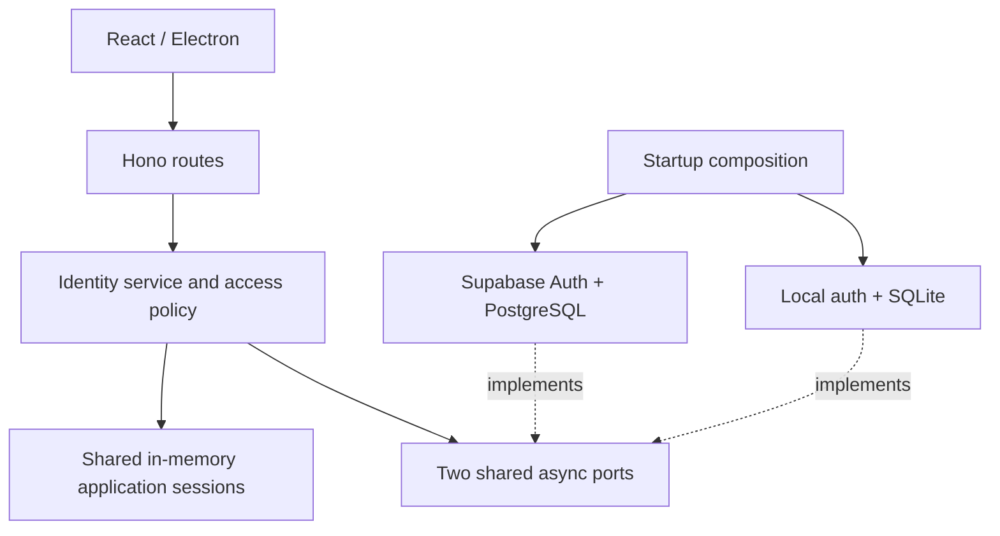

# Authentication migration — small-installation MVP

Status: proposed, documentation only. Current scale: four users and one management installation. This is the default implementation guide, not a hypothetical SaaS target. Based on develop through architecture-foundation; feat/supabase-migration is excluded.

## 1. Decision

Keep one application, two roles and two interchangeable infrastructure implementations. The core owns internal identity, authentication workflows, access status and authorization rules. SQLite/local authentication and Supabase implement the same application-owned async interfaces; neither imports the other. Supabase Auth handles authentication credentials and provider tokens, not product permissions.

Use React, Electron, Hono and TypeScript as today. For remote access use one trusted hosted Hono process, Supabase Auth and its PostgreSQL database; keep Playwright on the desktop. No new auth microservice, DI framework, ORM, Redis session store, event bus, background queue or generic database RPC. Reuse existing code where it works.



## 2. Minimal code layout

```text
server/
  modules/
    identity/
      domain/                  # existing identity and access-policy
      application/
        ports.ts               # two interfaces
        identity-service.ts    # login, grant, revoke, resolve session
      index.ts
      __tests__/
  infrastructure/
    local/
      identity-provider.ts
      identity-repository.ts   # wrap current SQLite stores
    supabase/
      identity-provider.ts
      identity-repository.ts   # English rows mapped to core
    sessions.ts                # provider-neutral in-memory session implementation
  app.ts                       # composition or a small factory called from here
supabase/
  migrations/                  # when implementing the remote adapter
```

Use plain functions or a small service object with dependency injection. Existing routes remain presentation; no separate command/handler, mapper class, entity base class or unit-of-work framework for every operation. Split files only when they become difficult to understand. Each module exposes index.ts. Keep the domain terminology from CONTEXT.md; new Supabase schema and persisted enum values use English.

## 3. Two shared ports

Illustrative target signatures, not implemented in this document:

```typescript
interface IdentityProvider {
  authenticate(input: LoginInput): Promise<VerifiedIdentity>;
  provision(input: EnrollmentInput): Promise<ProvisionedIdentity>;
}

interface IdentityRepository {
  findBySubject(subject: string): Promise<InternalUser | null>;
  findByProfessor(professorId: string): Promise<InternalUser | null>;
  findById(id: string): Promise<InternalUser | null>;
  save(user: InternalUser, expectedRevision: number | null): Promise<InternalUser>;
}
```

LoginInput, EnrollmentInput, VerifiedIdentity, ProvisionedIdentity and InternalUser are application-owned types. A verified identity is not an access grant. A provisioned identity is not necessarily verified. A provider subject is opaque and scoped to the configured provider/issuer. Use one provider per runtime; no need for a separate identity_links table. If an onboarding or recovery capability differs, make the difference explicit in the contract/UX; never claim verification that did not occur. Add recovery/logout provider methods only when those flows are wired. The provider adapter owns provider token handling, validation and cleanup; never expose refresh tokens to core entities or renderer.

Implement both ports using the local stores first, then implement the Supabase versions. Use Promise even for SQLite; do not emulate SQLite SQL in Supabase. Return the same domain types and error semantics. A single save is atomic, with a revision check and unique constraints. No generic transaction abstraction is needed for a one-row access transition. Add a real transaction-specific method when a use case needs atomic changes across rows.

Keep the existing in-memory application session mechanism as a shared, provider-neutral implementation, injected into the identity service; no separate session adapter for each provider or persistent session table now. Store token, internal user ID, grant revision and idle expiry; restart signs everyone out. Revoke individual sessions on logout and all sessions for a suspended user. Verify current user status/revision for every protected request, including after re-enable. Provider logout is additional cleanup, not the access authority.

```typescript
// At startup only; illustrative.
const identity = createIdentityService({
  ...(mode === 'local'
    ? createLocalIdentityInfrastructure(config)
    : createSupabaseIdentityInfrastructure(config)),
  sessions: createMemorySessions(),
});
```

The two bundles are alternatives for the same authoritative identity data. No automatic fallback, dual writes or implicit synchronization. Provider outage must fail closed in remote mode. Configuration chooses a provider once at startup, not inside each use case.

## 4. One new application table in Supabase

Supabase already supplies auth.users. For one auxiliary and a few professores, use a single application-owned table in an unexposed schema, iam.users. Combine internal identity, provider link and admission state in one row. No separate profiles, permissions, roles, grants, organizations or identity_links tables yet.

| Field | Purpose |
| --- | --- |
| id UUID PK | Stable internal identity, independent of provider |
| auth_subject TEXT NULL UNIQUE | Opaque provider identity; null before provisioning |
| role TEXT | teaching_assistant or teacher |
| account_id UUID NULL UNIQUE | Existing conta ID for auxiliar |
| teacher_id UUID NULL UNIQUE | Existing professor ID for teacher |
| status TEXT | pending, active or suspended |
| revision BIGINT | Increment on admission or security-sensitive transitions |
| created_at, updated_at | Basic traceability |

A professor cadastro may exist without a row in iam.users. A row for the auxiliar references the existing conta; a row for a professor references their existing professor ID. Enforce role-specific references (exactly one of account_id or teacher_id as appropriate), unique provider subject and professor link, active rows requiring a bound subject, and valid status values. Reserve pending rows before provisioning. Do not authorize by email, CPF or name. Do not duplicate password hashes, portal credentials or pedagogical data in iam. No required foreign key to auth.users, so the provider mapping remains replaceable. If a provider identity disappears, deny access until resolved.

SQLite may retain conta/professores and add only the fields needed for the shared contracts; map legacy names at the boundary. Preserve IDs and one authoritative admission flag. Do not force identical physical schemas. The old acesso_liberado must become a projection or be replaced when switching authority.

## 5. Simple onboarding and login

The auxiliar chooses a registered professor, grants access and supplies the verified-contact destination required by the chosen enrollment flow. Hosted Hono checks the active auxiliary identity and the target professor, reserves a pending internal user, and calls the server-only provider adapter to send an invitation. Supabase Auth manages the invitation and verification. Store the returned subject only against that reserved record; a matching email alone never establishes ownership. The professor accepts, authenticates and the core activates the pending user only if the binding is correct and the revision has not changed. A failed or uncertain invitation remains denied; with four users, reconcile manually rather than building a distributed provisioning system.

For remote mode, prefer a verified email invitation and independent application password or OTP. The current CONTEXT.md specifies CPF plus portal senha; changing to email is a proposed UX change and needs product approval. If the current UX is mandatory, design trusted portal identity validation and a supported exchange before remote launch. Do not copy portal senha into Supabase or trust an Electron assertion. The existing local login can stay during the refactor, but is not live portal validation.

On login, the provider proves identity; the core loads the matching internal user and requires active status; the application creates an opaque session. On suspension, the core saves suspended status with an incremented revision first, then invalidates sessions and closes/cancels related portal automation. Restore by an authorized action, increment revision and require a fresh authentication. Stale invitation acceptance cannot reactivate a suspended row. Do not require an event bus or durable provisioning journal for this.

## 6. Security that is not optional

- One trusted server-side authorization boundary: every protected list, read, mutation and nested reference is scoped to the authenticated professor's stored ID. The single auxiliar can manage the installation. No client-supplied role/owner, no UUID secrecy, no UI-only restrictions.
- Explicit professor DTOs omit auxiliary financial values and credentials; other professors' records are never sent to the client. Keep portal credentials encrypted, separate from application auth and preferably local. Never copy the entire auxiliary database or encryption key to another device.
- Verify provider tokens with supported SDK verification, issuer, audience and expiry; do not trust user-editable metadata, email matching or session retrieval alone. Check active core status and revision regardless of valid provider JWT. No public self-enrollment.
- Secret/service-role keys, privileged clients and database credentials stay on the hosted server, never Electron. Use HTTPS, rate limits, safe invitation redirects and protected token handling. No bearer/refresh tokens in renderer localStorage or sensitive logs.
- iam stays outside exposed Data API schemas; deny public/client grants, use least privilege and RLS as defense in depth. If exposing tables, use ownership policies on all operations. Do not use broad authenticated-only policies.
- Preserve restricted primeiro acesso in local mode; provision remote auxiliar through a trusted operator, not a bundled default password. Bind portal sessions to authenticated actor and target professor, recheck on resume.
- Before a second independent management customer, implement explicit organization/membership or equivalent trusted scope and negative cross-tenant tests. Four users do not justify weaker isolation within the current installation.

## 7. Deployment and data scope

Local mode remains a trusted single-installation desktop Hono with SQLite. Remote mode uses one hosted Hono process with the Supabase adapter; all remote clients are untrusted. An authenticated professor on another device cannot read the auxiliary's local SQLite simply because Supabase login works. Provide a scoped hosted data path for the relevant pedagogical records before cross-device launch. Move only required data in a separate migration; do not expose raw SQLite, use a generic store RPC or ship the whole database. Do not implement offline remote authorization: if live access cannot be checked, deny remote protected actions.

## 8. Incremental migration

| Step | Work | Done when |
| --- | --- | --- |
| 1 | Fix suspension of active legacy sessions; characterize current auth | Negative tests pass |
| 2 | Extract two async ports and identity service, wrap SQLite, reuse memory sessions | Current HTTP/data contracts preserved |
| 3 | Implement English iam.users schema and Supabase adapters locally | Same contract tests and database privilege tests pass |
| 4 | Wire auxiliary grant/invitation, login and suspend/restore; provision auxiliary securely | Pending/foreign identities denied; no leaked secrets |
| 5 | Preserve existing IDs; enroll current professores deliberately; select remote mode | Approved login UX, tested backup/rollback, no weaker fallback |
| 6 | Provide scoped remote pedagogical data path | Cross-professor read/write tests pass before launch |

Keep existing HTTP endpoints where possible. Use local provider tests and the same repository contract tests for Supabase: missing records, unique subjects/professor IDs, stale revision and consistent errors. Test expired/revoked sessions, restoration, pending/wrong identities, cross-professor reads/writes, financial fields, portal ownership, provider outages and denied direct database access. Run pnpm typecheck, pnpm lint, pnpm test and real local Supabase integration tests before deployment.

## 9. Explicitly deferred

| Defer | Trigger for reconsideration |
| --- | --- |
| Separate grant/role/link tables | Multiple roles, multiple providers per user or multiple grants per professor |
| Organizations and memberships | Before a second independent management customer |
| Persistent or distributed sessions / Redis | Multiple API replicas or required session survival across restarts |
| Generic unit of work | Several use cases actually need multi-repository atomicity |
| Durable provisioning journal or workers | Enrollment failures or throughput make manual reconciliation impractical |
| Event bus/outbox, elaborate DDD, monorepo split | Real cross-module delivery, reliability or packaging requirements |

This guide is documentation only. No schema, dependencies, deployed Supabase project or runtime code are changed. Verify current Supabase SDK/CLI docs before implementation: https://supabase.com/docs/guides/auth and https://supabase.com/docs/guides/database/postgres/row-level-security.
