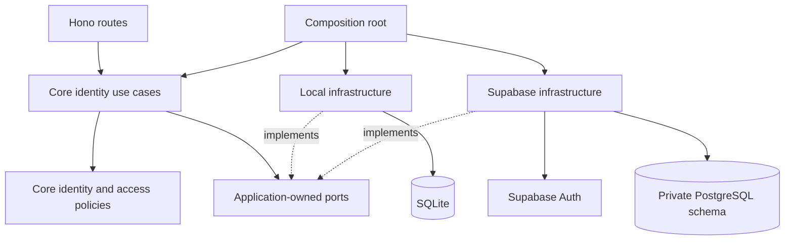

# Authentication migration: interchangeable infrastructure

Status: proposed target; documentation only. Based on the architecture foundation branch from develop. The separate feat/supabase-migration branch is excluded.

## Decision

The application core owns internal identity, authentication workflows, papel de acesso, professor access grants, ownership policies, and application session lifecycle. SQLite/local authentication and Supabase are independent infrastructure implementations of the same application-owned ports. Neither imports the other. The core imports neither.

Use the existing React, Electron and Hono stack. No dedicated auth microservice, generic database RPC, or full pedagogical migration is required for the identity refactor.

Supabase Auth verifies credentials and manages provider credentials, tokens and recovery; it does not decide product permissions. The core owns identity and access records even when physically persisted in Supabase PostgreSQL. Never duplicate provider password hashes or copy portal passwords into Supabase Auth.

## Dependency direction



The composition root selects the implementation once at startup. No provider conditionals in use cases, no provider SDK types, SQL, table names, JWT claims, or transport-specific errors in core contracts. Other modules use identity's public index. Select a complete, compatible identity bundle; do not mix unrelated identity stores and authentication providers accidentally.

## Target layout

```text
server/
  modules/
    identity/
      domain/
      application/
        ports/
          identity-provider.ts
          user-repository.ts
          access-repository.ts
          session-store.ts
          identity-unit-of-work.ts
        use-cases/
      presentation/
      index.ts
  infrastructure/
    local/
      authentication/
      repositories/
      sessions/
      mappers/
      database/
    supabase/
      authentication/
      repositories/
      sessions/
      mappers/
      database/
  composition/
    local.ts
    remote.ts
  app.ts
supabase/
  migrations/
```

Move one real slice at a time. Existing server/conta and professores stores become compatibility adapters first; do not move the entire repository in one PR. Export only the public core contracts needed by the composition root. Infrastructure may be grouped by technology rather than embedded in each module; the same dependency rule applies.

## Shared contracts (illustrative)

The contracts use asynchronous methods so synchronous SQLite can implement them without forcing Supabase to imitate synchronous SQL. The types below are illustrative application-owned types, not implemented signatures. Extend them only for concrete use cases. Preserve Portuguese domain vocabulary in core; English physical schema and adapter DTOs are intentional.

```typescript
interface IdentityProvider {
  authenticate(input: AuthenticationInput): Promise<VerifiedIdentity>;
  verify(proof: ProviderProof): Promise<VerifiedIdentity>;
  provision(input: EnrollmentInput): Promise<EnrollmentResult>;
  revoke(providerSession: ProviderSessionRef): Promise<void>;
}

interface UserRepository {
  findById(id: UserId): Promise<InternalUser | null>;
  findByExternalIdentity(identity: ExternalIdentity): Promise<InternalUser | null>;
  save(user: InternalUser): Promise<void>;
}

interface AccessRepository {
  findByProfessor(professorId: ProfessorId): Promise<ProfessorAccess | null>;
  findByUser(userId: UserId): Promise<ProfessorAccess | null>;
  save(access: ProfessorAccess, expectedRevision: number): Promise<void>;
}

interface SessionStore {
  create(session: ApplicationSession): Promise<void>;
  find(id: SessionId): Promise<ApplicationSession | null>;
  revoke(id: SessionId): Promise<void>;
  revokeByUser(userId: UserId): Promise<void>;
}

interface IdentityUnitOfWork {
  run<T>(work: (repositories: IdentityRepositories) => Promise<T>): Promise<T>;
}
```

AuthenticationInput and EnrollmentInput describe product-level requests rather than Supabase email APIs. VerifiedIdentity carries verified external identity (provider, issuer, subject), not trusted product permissions. ProviderProof and ProviderSessionRef are opaque to the core; secret material is handled by infrastructure and never serialized to ordinary DTOs. Define a consistent typed error taxonomy (invalid credentials, unavailable, conflict, expired, not found), expiry semantics, null behavior, optimistic concurrency, and atomicity. IdentityRepositories provides transaction-bound repositories; do not attempt to wrap separate remote HTTP writes in a fake transaction. A server-side PostgreSQL transaction or one transactional RPC can implement the atomic contract.

Local provisioning must also prove control of the intended account/credential before activation; it must not report email verification it cannot perform. Provider-specific enrollment delivery and recovery UX may differ behind transport adapters; product-level admission and security guarantees may not. A capability unavailable locally must fail explicitly rather than pretending success.

| Port | Local implementation | Supabase implementation |
| --- | --- | --- |
| IdentityProvider | LocalIdentityProvider (existing local verification behind a port) | SupabaseIdentityProvider |
| UserRepository | SQLiteUserRepository | SupabaseUserRepository |
| AccessRepository | SQLiteAccessRepository | SupabaseAccessRepository |
| SessionStore | MemorySessionStore initially or SQLiteSessionStore | Server-side session store backed by private PostgreSQL or memory for a single process |
| IdentityUnitOfWork | SQLiteIdentityUnitOfWork | PostgreSQLIdentityUnitOfWork |

Provider sessions and application sessions are distinct. Supabase Auth session validity is not authorization; application session rules are identical in both modes. Session IDs are generated securely; store only token hashes where appropriate. Use shared contract suites against each adapter and fake ports for pure use-case tests. Never hide semantic differences behind identical method names.

## Composition and runtime modes

```typescript
// Composition only; illustrative.
const dependencies = mode === 'local'
  ? createLocalInfrastructure(config)
  : createSupabaseInfrastructure(config);

const identity = createIdentityModule(dependencies);
```

Local: trusted local Hono + SQLite + local authentication; database stays on the authorized installation. Remote: hosted Hono + Supabase Auth + private PostgreSQL repositories; the renderer and desktop are untrusted clients of the remote authority. Do not package server-only Supabase adapters/secrets in Electron. If remote auth is introduced before migrating pedagogical data, do not claim that professores can access the auxiliary's local SQLite from another machine. Cross-device access requires a scoped hosted data path first. Never distribute the full auxiliary database or encryption key to professores.

The two implementations are alternatives for an authoritative data set, not automatic mirrors. No silent fallback to SQLite on remote outages or rejected credentials. No dual writes, implicit synchronization or provider switching during a request. If hybrid deployment is needed, define authority by module/aggregate and design explicit sync separately. Offline access after central revocation cannot be guaranteed; deny protected remote actions when live admission cannot be checked.

## Minimal model: fresh English schema

The core uses its own stable user ID and existing professor/conta IDs, independent of external subjects. A professor cadastro can exist without an application user. For one management installation, use three application-owned tables in private schema iam, in addition to Supabase-managed auth.users:

| Table | Proposed columns |
| --- | --- |
| users | id UUID PK, role, status, core_account_id UUID nullable, session_revision BIGINT, created_at, updated_at |
| identity_links | id UUID PK, user_id UUID FK, provider, issuer, subject, created_at |
| teacher_access | id UUID PK, core_teacher_id UUID, teacher_user_id UUID nullable FK, granted_by_user_id UUID FK, status, revision BIGINT, created_at, updated_at |

Persist English roles teaching_assistant and teacher, user statuses pending/active/suspended, grant statuses pending/active/suspended/revoked. Map at the repository boundary to core terms. Enforce unique (provider, issuer, subject), unique core_teacher_id and unique non-null teacher_user_id. Active access requires an active teacher user and eligible grant; issuer must be an authorized auxiliar at the time of granting. Use transactional checks and compare-and-set revisions. Do not infer identity from matching email, name or CPF. No hard FK to auth.users is required for portable provider links; missing provider identity fails closed. SQLite may retain legacy Portuguese names behind mappers or adopt the new logical model through migrations; no physical schema parity requirement. Session persistence tables are optional infrastructure details, not a fourth required business entity.

Before sharing a deployment across multiple management customers, introduce trusted organization/membership or equivalent ownership boundaries and scope every resource and grant. The single-installation model is not safe for multi-tenant hosting.

## Grant access and login

1. The auxiliar selects an existing professor. The core checks the actor and the target's management scope, reserves a pending internal user/grant with stable IDs, then requests enrollment through the provider port.
2. In remote mode, the recommended enrollment mechanism is a verified email invitation and an independent application password or approved OTP. A server-only Supabase admin adapter performs invitation delivery. The returned provider ID is a binding candidate, not proof of verified email. Bind the verified external identity only to the reserved internal user. Unrelated existing accounts and ambiguous provider responses require reconciliation; never link by matching email alone.
3. On successful enrollment, the core atomically activates user and grant if still eligible. A verified provider account without active core access has no application access. Failed or uncertain provisioning stays pending/denied. Do not blindly retry provider creation or delete ambiguous accounts.
4. On login, resolve verified provider identity -> internal user -> active grant -> existing professorId. Create an application session with the current session and grant revisions. Check live status and revisions on protected requests.
5. Suspension/revocation updates the core grant first and increments its revision; invalidate application sessions, revoke provider sessions as appropriate, and close/cancel associated portal automation where possible. Restore access with a new revision and fresh authentication. Never revive an old session or let stale acceptance reactivate a revoked grant.

CONTEXT.md currently specifies CPF and portal senha. Email invitation with independent credentials is a proposed UX change requiring approval. Native Supabase email/password login does not itself establish portal identity. If CPF + portal senha must remain, design a trusted portal validation and supported provider integration before enabling remote login. Do not silently copy the portal senha into Supabase. Existing local behavior may remain during the incremental refactor, but is not proof of live portal validation.

## Authorization and sensitive data

Use core policies for actor/action/resource. Every server-side read, list and mutation must constrain trusted professorId and management scope; validate nested turma, matrícula, etapa, avaliação and portal session references. A professor cannot manage access, view another professor's records or read auxiliary financial values. Explicit DTOs exclude portal credentials and financial fields. Do not rely on hiding buttons, UUID secrecy, JWT roles or generic URL inspection alone.

Keep portal credentials separate, encrypted with the existing OS-backed mechanism where feasible; no portal password in Auth, identity schema, logs or ordinary DTOs. Remote credential storage requires a separate threat model. Never copy the full local database to professor devices.

Verify provider tokens with supported SDK verification and check issuer, subject, audience and expiry; never trust user-editable metadata or session retrieval alone. Keep secret/service-role keys and DB credentials hosted only. Use HTTPS, invitation redirect allowlists, rate limits and verified enrollment. Keep iam out of exposed Data API schemas, revoke public/client access, use least-privilege roles and RLS as defense in depth. If a table is exposed later, require ownership policies for all operations, including UPDATE checks. Keep refresh/bearer tokens out of renderer localStorage and logs. Record grant transitions without sensitive payloads. Provider logout alone is not immediate revocation of issued JWTs; live core grant and session checks are mandatory.

## Migration sequence

| Step | Scope | Gate |
| --- | --- | --- |
| 1 | Characterize legacy behavior; fix active-session suspension and restricted primeiro acesso | Negative tests |
| 2 | Extract asynchronous shared ports, use cases and local adapters | Existing API and SQLite behavior preserved |
| 3 | Add adapter contract suites and explicit composition | Same suite passes with local/fake implementations |
| 4 | Create fresh Supabase schema, repositories and provider adapter in local environment | Same contract suite, privilege and transaction tests |
| 5 | Provision auxiliary securely; implement managed grant/enrollment/revoke | No public self-enrollment, no embedded bootstrap password |
| 6 | Map existing access-enabled professores to pending enrollment, preserve IDs | Approved login UX, no password export |
| 7 | Select remote bundle at deployment; remove weaker fallback | Backup, rollback drill, live revocation |
| 8 | Enable scoped remote pedagogical data path | Cross-professor tests; tenant isolation before shared hosting |

Keep legacy HTTP endpoints as compatibility adapters where feasible. acesso_liberado becomes a projection of the authoritative core access grant after cutover, not a second authority. Do not create Supabase migrations until implementation; use the installed CLI's documented migration workflow. No hosted database changes are authorized by this document.

## Acceptance tests

- Run identical repository/session contract suites against local and Supabase implementations: missing records, uniqueness, stale revisions, atomic rollback, revocation and error mapping.
- Run identity use cases with fake ports, independent of the SDK and database.
- Valid provider account without active core grant is denied; stale, expired and revoked sessions are denied in both modes.
- Professor A cannot list/read/write/delete professor B's records, nested resources or portal sessions; no auxiliary financial values or foreign credentials leak.
- Pending enrollment, wrong identity, duplicate grants, stale invitation and provider outages cannot grant access.
- Static boundary checks forbid provider dependencies in domain/application and imports between infrastructure implementations. Update the existing architecture test when moving adapters.
- Run pnpm typecheck, pnpm lint, pnpm test and real local Supabase integration/privilege tests before deployment.

References for implementation: [Supabase Auth](https://supabase.com/docs/guides/auth), [sessions](https://supabase.com/docs/guides/auth/sessions), [RLS](https://supabase.com/docs/guides/database/postgres/row-level-security). Verify current SDK and CLI documentation before implementing. This is a design proposal, not a tested or deployed integration.
