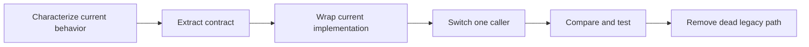

# Incremental migration guide

## Non-negotiable rules

1. Start each slice from the current develop, not an unrelated provider migration. Record the existing HTTP contract, domain behavior, persistence and side effects.
2. Refactor one vertical slice at a time. Add characterization tests before moving behavior; isolate bug fixes from structural commits.
3. Extract pure rules first. Define ports at actual I/O seams, not for every function. Reuse current SQL and Playwright implementations as adapters.
4. Wire the new use case to existing routes. Keep endpoint paths, statuses, DTO shapes, stored IDs and migrations compatible. Keep temporary re-exports for old callers; do not duplicate business logic.
5. Preserve first access, role restrictions, resource ownership, financial redaction and human review. Newly migrated actions explicitly authorize actor + action + trusted resource, including nested references.
6. Keep modules' dependency graph acyclic. Use their public index. Do not import legacy stores into new domain/application code; wire them from adapters or composition.
7. Preserve database transactions and idempotency. Never mark a portal write confirmed based only on a successful automation call. Use a new read to verify; distinguish failure, pending verification and conflict.
8. Move schema and provider changes in separate, reversible releases. Add/backfill/validate before switching readers; remove old fields only after recovery is tested. Back up data before destructive migration; preserve encrypted credential decryptability.
9. No secrets, CPF, passwords, session tokens or identifiable estudante data in logs, fixtures or LLM context unless explicitly necessary and protected.
10. Run typecheck, lint, unit/contract/integration tests and the existing browser tests where applicable. A failure blocks the slice from being considered complete.

## Branch by Abstraction

Keep compatibility exports until all callers are migrated. Avoid a folder-only refactor and avoid introducing a parallel backend. Prefer a single authoritative path. For stateful changes, rollback means restoring a compatible release and data backup, not silently falling back to weaker authentication.

## Default scope for four users

Prioritize identity, access revocation, portal-session ownership and regression tests. Keep a single service per small module, two shared async identity ports and in-memory application sessions. Do not pre-create the full module map or introduce generic transactions, separate grants/roles tables, Redis sessions, queues, event bus, worker or monorepo packages. Refactor other modules only when a change exposes a real problem. The [small-installation authentication guide](authentication-migration.md) is the implementation target; later phases below are conditional, not required for the MVP.

## Ordered work

| Phase | Scope | Exit criteria |
| --- | --- | --- |
| 0 | Architecture foundation (this branch) | Real identity slice called by existing middleware; public contract; boundary and unit tests |
| 1 | identity + authorization hardening | Deny suspended professores with existing tokens; revoke all relevant sessions; explicit authorization actions; strict primeiro acesso route allowlist |
| 2 | portal sessions and credenciais do professor | Bind headed/headless sessions to authenticated actor and target professor; check authorization on resume; cleanup on logout/expiry/revocation; protect secrets |
| 3 | professores / academics | Separate cadastro and identity; migrate discovery and relationships; validate período letivo and matrícula invariants |
| 4 | cadernetas | Extract grouping and completion policies; move one endpoint at a time; retain route contracts and grouping data |
| 5 | boletim / fichas | Pure classificação, nota distribution and conceito progression policies; boundary tests for grouped turmas and portal precedence |
| 6 | portal adapters and operations | Isolate page selectors, normalized DTOs and session state; typed operation lifecycle; safe retries and verification |
| 7 | assistants | Structured output validation, scope, human approval, privacy-safe context and durable rascunhos if product requires |
| 8 | Remote identity/data | Two shared identity ports, Supabase Auth adapter, one English identity table, scoped repositories and schema migration; no weaker fallback. Organizations before a second management customer; subscriptions only when required. |
| 9 | deployment and observability | Cloud authorization and validated client results; job durability/outbox only where needed; audit and operational metrics |
| 10 | workspace evolution | Separate apps/packages only when executable boundaries justify it; retire shims and tighten CI rules |

The [authentication migration guide](authentication-migration.md) defines independent SQLite/local and Supabase adapters of identical core-owned async contracts. Migrate and test the local adapter first, then implement the remote bundle. Never silently fall back, dual-write or share concrete infrastructure across bundles. Identity/provider integration can move earlier if its required security gates and contract tests are complete. Single-installation remote hosting requires professor-level isolation; a second independent management customer requires organization isolation before onboarding. No new dependency, framework or queue is required for phases 0–2.

## Known debt and progress after phase 0

- 0001-auth rechecks active professor status and closes sessions on API suspension. Local first-access links are implemented; verify expiry, replay, revocation, and legacy CPF migration with tests. The remote provider and e-mail delivery remain pending.
- Generic caderneta middleware inspects URL/body/query; migrate to explicit per-action checks with trusted ownership resolution. Keep current guards until replacements cover all routes.
- Portal browser sessions are associated with professorId; bind them to actor/auth session and revalidate on resume. Do not assume logout already closes them.
- Financial response filtering is a compatibility guard, not a final authorization design. Use explicit DTO projections and write permissions.
- Single conta lookup and shared auxiliary scope must not be reused as-is in a multi-tenant API.
- Local portal password comparison is not live portal validation. Preserve current login contract while separating identity and credential concerns; do not synchronize portal passwords into a new provider without a documented threat model and product decision.

## PR checklist

- [ ] Document the slice, invariants, public contract and compatibility path.
- [ ] Add or update characterization tests and negative authorization tests.
- [ ] Verify domain/app layers do not import infrastructure.
- [ ] No unintentional API, schema, data, session or UI changes.
- [ ] Verify migrations/rollback and error/timeout paths where applicable.
- [ ] Run `pnpm typecheck`, `pnpm lint`, `pnpm test`; for targeted work, also use `pnpm exec vitest run <path>`.
- [ ] Run relevant Playwright/browser/Electron smoke checks where required.
- [ ] Remove compatibility code only after all callers move.
- [ ] Document intentional changes and remaining debt.

The architecture test is a static check over TypeScript imports in server code, not a complete security proof. Extend it when introducing aliases, workspace packages or new runtime loading patterns.
