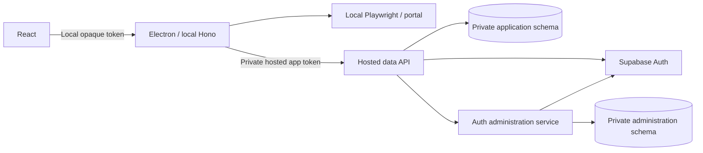

# Supabase Postgres setup and rollout

Hosted persistence keeps the desktop and portal automation on the computer. Application data and the Auth administration journal move to Supabase Postgres. The desktop connects to a controlled data API over HTTPS and receives no database password or administrative key.



## Rollout plan

1. Complete the [Auth configuration](supabase-auth.md) using the same project and intended auxiliar identity.
2. Apply the versioned database migrations and provision separate runtime logins.
3. Configure and start the administrative service, then the data API. They can share the same controlled host.
4. When migrating an existing administrative SQLite journal, stop its old process, import its journal, and retain its original journal key before restarting on Postgres.
5. Close the previous desktop app and back up its SQLite database. Keep its original OS keychain available. Complete any pending Auth confirmations or credential synchronization before importing.
6. Point the desktop at the data API, complete primeiro acesso if requested by the new hosted conta, and choose **Conta → Dados anteriores → Importar dados anteriores** before creating new professores.
7. Sign in again, check both papéis de acesso and a sample turma, caderneta, boletim, and financial values, then distribute the configured desktop build.

The implementation has been tested on an isolated local Supabase stack. Applying migrations to the actual hosted project, configuring SMTP, and checking real portal credentials are deployment steps, not actions performed by the local tests.

## Apply migrations

Use Supabase CLI v3.2.0 and inspect its help before changing targets:

```bash
pnpm dlx supabase@3.2.0 db push --help
pnpm dlx supabase@3.2.0 db push --remote --dry-run
pnpm dlx supabase@3.2.0 db push --remote --yes
```

`--remote` uses the explicitly linked project. Link the intended project first using the installed CLI's `link --help`; do not run these commands against an unreviewed target. The dry run should list only the application-schema, administration-journal and turmas-de-redução/fichas migrations in `supabase/migrations/`. Use a scoped operator token when a Management API token is required. Native database credentials belong only in the controlled operator environment.

The schemas `esmeraldinha` and `esmeraldinha_auth_admin` are deliberately absent from the exposed Data API schemas. Do not grant their tables to `anon`, `authenticated`, or `service_role`, or add them to public Data API settings. Application authorization runs through the data API, including the CPF/portal-senha compatibility rule.

## Provision runtime logins

Copy `server/database/operator.env.example` to `server/database/.env.operator`. Set an administrative connection URL and two distinct random database passwords. `openssl rand -base64 32` produces a suitable password; generate each separately.

```bash
pnpm db:provision
```

This creates `esmeraldinha_api` for application data and `esmeraldinha_auth_admin_api` for the journal, without printing passwords. Existing logins are not replaced automatically. Keep administrative credentials out of both runtime connection URLs.

Choose the endpoint from the project's **Connect** dialog. A persistent backend can use the direct endpoint where IPv6 is available, or the shared session pooler on IPv4. Preserve the pooler's project suffix when changing its username to a runtime login. The driver uses unnamed statements and also supports transaction pooling. [Connection methods](https://supabase.com/docs/guides/database/connecting-to-postgres)

Remote connections always verify TLS certificates. Set `DATABASE_CA_PATH` to the project's CA certificate if needed. Connection-string query options cannot disable verification or replace the application's schema. Plain TCP is accepted only for loopback development.

## Start the administration service

Set `AUTH_ADMIN_DATABASE_URL` in `server/auth-admin/.env` to the journal runtime connection URL. Retain the Supabase secret key, expected auxiliar UUID, and stable `AUTH_ADMIN_JOURNAL_KEY` from the Auth setup.

```bash
pnpm build:auth-admin
pnpm start:auth-admin
```

Without `AUTH_ADMIN_DATABASE_URL`, the service retains its explicit SQLite mode for Auth-only installations. A configured Postgres failure never falls back to that file.

If an older hosted journal exists, stop its process, back up its file, and set `AUTH_ADMIN_LEGACY_DB_PATH` to that backup. Keep the original HMAC journal key:

```bash
pnpm db:import-auth-journal
```

The command reads the source without modifying it, imports into an empty journal transactionally, and reports only counts. An exact repeat is allowed; a different existing destination is rejected. Start only one administration process after the transfer.

## Start the data API

Copy `server/database/.env.example` to `server/database/.env` and set:

| Setting | Value |
| --- | --- |
| `DATABASE_URL` | Application runtime connection URL, using `esmeraldinha_api` |
| `DATABASE_CA_PATH` | Optional project CA certificate path |
| `SERVER_ENCRYPTION_KEY` | Separate stable 32-byte random key, encoded as base64 |
| `ENCRYPTION_ADAPTER` | `server` |
| `SUPABASE_URL`, `SUPABASE_PUBLISHABLE_KEY` | Public configuration for the same project |
| `SUPABASE_AUXILIAR_AUTH_ID`, `SUPABASE_AUXILIAR_EMAIL` | Explicit expected identity |
| `SUPABASE_AUTH_ADMIN_URL` | Administration endpoint; loopback is suitable on the same host |
| `DATA_API_PORT` | Default `3003` |

Generate a separate server encryption key, back it up securely, and retain it across deployments. Replacing it without re-encrypting stored data makes portal senhas unreadable. It is independent of database passwords and the administration journal key.

```bash
pnpm build:data-api
pnpm start:data-api
```

Use `pnpm dev:data-api` during development. The service binds to `127.0.0.1`; expose it through an HTTPS reverse proxy. Disable request-body logging on the data and Auth endpoints. The import handles plaintext senhas only transiently for re-encryption.

Run one instance of each service: app sessions and per-professor coordination are process-local. A restart requires signing in again. Back up Postgres and the two stable encryption/HMAC keys. The runtime data role cannot use the administration schema, and the administration role cannot read application data.

## Configure and import from the desktop

Set only this public setting on the desktop:

```dotenv
ESMERALDINHA_DATA_API_URL=https://your-controlled-data-api.example/
```

During development, place it in the root `.env` or `server/.env`. Installed builds use the GitHub Actions repository **Variable** with the same name. The build rejects nonlocal HTTP URLs, embedded credentials, queries, and fragments. The earlier public Supabase settings remain relevant to the direct-Auth/SQLite mode; the hosted data mode gets its configuration through the controlled API.

The old SQLite path stays available as the import source. Open **Conta → Dados anteriores** on the original computer, with its keychain unlocked, and import before creating professores in the hosted app. The import preserves local IDs, contact/profile data, turmas, estudantes, cadernetas, boletim, financial values, and the catálogo de códigos CR. Existing Auth UUIDs must belong to the same project and the same administrative assignments. Unlinked professores remain disabled until enrolled.

The import reads a consistent snapshot and never upgrades or edits the source file: it upgrades a private temporary copy to the current schema, so an installation that never opened the newer local schema still exports its turmas de redução, fichas and classificações. It decrypts portal senhas on the original computer, sends them only from the local Node process to HTTPS, and encrypts them with the server key before inserting them. The renderer receives only counts. OS-keychain ciphertext cannot be imported from a different computer as if it were portable. Development databases require their original development encryption key.

The request limit is 32 MiB. Large images contribute to that limit; review the payload size before a larger installation rollout. The target must have no professores, turmas, or cadernetas. Pending Auth operations and unconfirmed enrollment must be completed before import. A database failure rolls back the whole import. A lost response can be retried after signing in again: the same source/payload is recognized without overwriting subsequent cloud changes.

After a successful import, sign in again because the preserved conta ID replaces its temporary hosted record. Professores continue entering with CPF and their synchronized portal senha. Confirm their access and caderneta ownership before releasing the new installer.

## Validation and recovery

```bash
pnpm typecheck
pnpm lint
pnpm test
pnpm build
pnpm build:electron
pnpm build:auth-admin
pnpm build:data-api
```

The optional native integration test requires an empty disposable local project in a directory named `esmeraldinha-postgres-validation-*`, with these migrations applied and its private `supabase status -o json` output saved as `status.json`:

```bash
SUPABASE_POSTGRES_TEST_STATUS_PATH=/path/to/esmeraldinha-postgres-validation-test/status.json pnpm exec vitest run server/__tests__/postgres-local.integration.test.ts
```

It verifies native Auth, both Postgres runtime roles, the compiled data service, source preservation, re-encryption, rollback, idempotency, authorization, financial restrictions, revocation, and connectivity failures. Set `SUPABASE_POSTGRES_ELECTRON_SMOKE=1` after building the desktop to include its `app://` login; use `xvfb-run -a` on headless Linux. Portal calls are mocked in this test.

Weekly portal synchronization still requires the desktop to remain open, an active full auxiliar session, and access to the local browser. Background work does not renew the desktop's idle deadline.

Before production import, keep a source backup and check the target project. Until hosted writes begin, rollback consists of closing the new app and restoring the explicitly configured local mode with the preserved source/keychain. Once people have edited hosted data, stop writes and plan a controlled restore or reverse import; an old local backup does not contain those edits. No network failure automatically reactivates SQLite or an older local senha.
